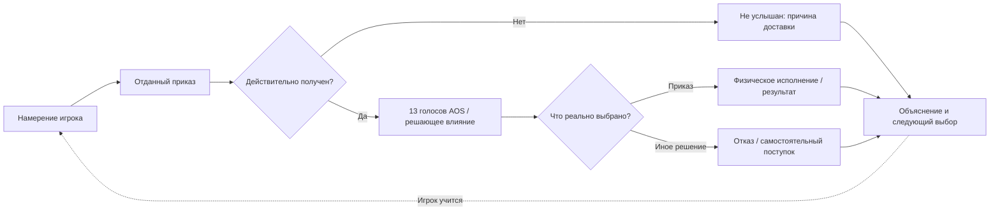
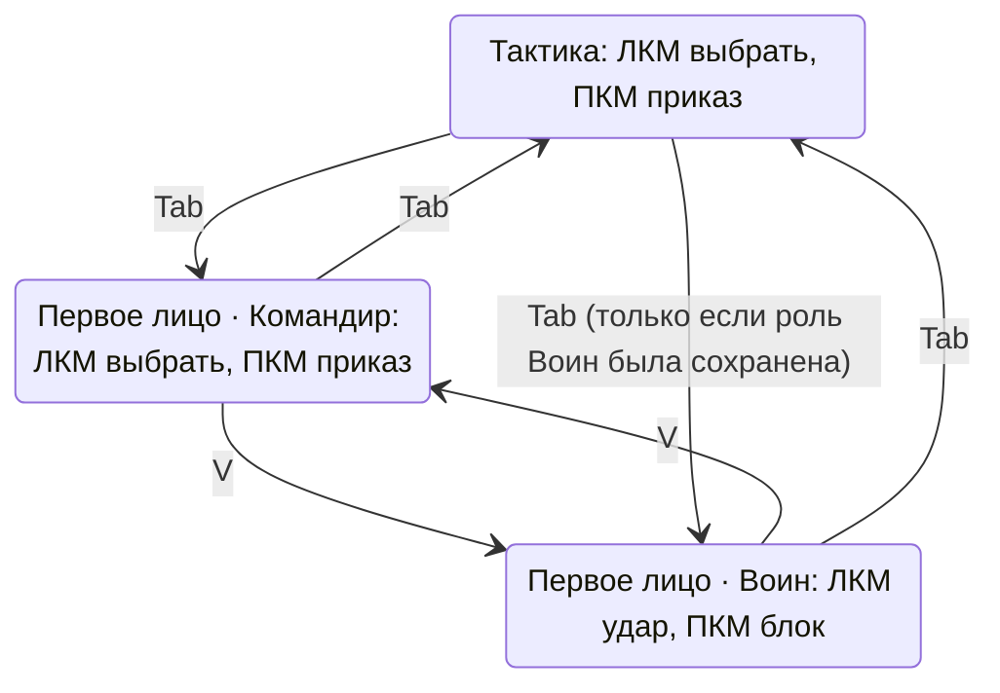
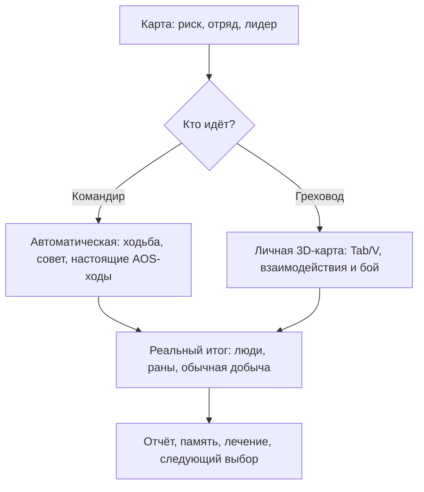
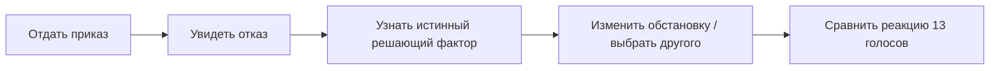

# Sinbinder: тотальное исследование UX Греховода — результаты и план приёмки

**Дата:** 14.11.2026. **Рабочая ветка:** `feature/server-prototype`. **PR №1:** draft.  
**Тип документа:** исследование и дизайн-предложения; **не означает**, что новый UX уже применён в Unity.  
**Основа:** эвристики NN/g, Celia Hodent, Game Accessibility Guidelines, Xbox Accessibility Guidelines и сравнительные примеры *This Is the Police*, *Darkest Dungeon*, *Into the Breach*, *XCOM 2*, *RimWorld*. Код Unity и C# прочитан в ветке. **PlayMode, исследование реальных пользователей и запись экрана не проводились**.

## Главный вывод

Sinbinder должен показывать самостоятельность души **честно**, а не превращать NPC в полностью послушные юниты. Хороший UX = игрок может ответить на четыре вопроса:
1. **Что я приказал?**
2. **Кому и дошёл ли приказ?**
3. **Что действительно решил и сделал воин?**
4. **Почему и что я могу изменить?**

Сложность в морали/риске/психологии — задуманный геймплей; путаница с Tab/V, доставкой команды, физическим исполнением, переходами сцен и сохранениями — **не** задуманный вызов.

## Реальные хорошие решения, сохранять при изменениях

- `Assets/Scripts/Gameplay/RTS_Camera.cs`: **Tab** переключает тактический вид/первое лицо; **V** переключает Командир/Воин только в первом лице, **не меняя камеру**. Командир: ЛКМ выбор, ПКМ приказ; Воин: ЛКМ удар, ПКМ блок. `MouseActionsReady` требует отпустить обе кнопки после переключения, предотвращая ошибочный удар/приказ.
- `AOSWarriorWrapper.cs`: оригинальный `BehaviourResolver`, `LastDecisionDetail`, `NaturalDecisionDetail`, `CommandRevision`, отдельный Whisper, события отказа. **Не заменить** 13 голосов случайным шансом и не подменять причинность вымышленным текстом.
- `UI/CommandPanel.cs`, `UI/ScalesOverhead.cs`, `UI/BattleLogUI.cs`: уже существуют прогноз приказа, краткие весы и журнал. **Нужно объединить информационную иерархию**, а не добавить ещё одну панель, показывающую всё сразу.
- `DreamTutorialDirector.cs`: урок AOS и суд души основаны на реальных событиях; сохранить строгого, саркастичного Бога Смерти и принудительный возврат с запрещённого маршрута, но проверить когнитивную нагрузку.
- `MissionBoard.cs`, `PersonalExpedition.cs`, `MissionMapUI.cs`: настоящие походы и физические карты Соляного обоза/Придорожной часовни, последствия, ранения и возвращения. Сохранить запрет автоматического сбора душ/секретов.

## Подтвержденные риски и предложения (P0 / P1 / P2)

| ID | P | Что установлено | Действие в production Unity |
|---|---|---|---|
| UX-01 | **P0** | Приказ, получение, решение AOS и физическое действие представлены разными компонентами; нет единого пользовательского контракта исхода. | Связать выдачу приказа `SelectionManager`, подтверждение приема, `LastDecisionDetail`, отказ и факт движения через одну семантическую UX-цепь. **Не** выдавать «услышал» без события получения. |
| UX-02 | **P0** | `PersonalExpedition.BeforeSaveOrLoad()` вызывает `_active.Exit()` и завершает посещение карты перед сохранением. | Полная сериализация реальной карты/позиций/NPC/лута/команд; пока её нет — честное подтверждение возвращения вместо неожиданного выхода. |
| UX-03 | **P1** | ЛКМ/ПКМ имеют разную семантику при V в одном виде от первого лица. | Постоянный компактный индикатор Командир/Воин/Тактика и контекст ЛКМ/ПКМ; сохранить защиту зажатой мыши. |
| UX-04 | **P1** | У `DreamTutorialDirector` ~25 логических стадий: AOS, роль, оружие, лук, спасение, эмоции, головоломка и т. д. | Замерить прохождение новичками; дать короткую первую петлю «приказ → неповиновение → причина → другое решение». Остальные навыки распределить по эпизодам. |
| UX-05 | **P1** | `MissionMapUI.ShowMissions` смешивает текущие походы, лечение, архив реплеев и новые миссии в одной прокручиваемой ленте. | Видимые разделы «Сейчас / Новый поход / Отряд / Архив» без второго движка и пересчёта исходов. |
| UX-06 | **P1** | `TemperamentPredictor` использует 4 **синтетических** контекста. | Прогноз писать условно; не обещать 100%-ное выполнение и не изобретать проценты. |
| UX-07 | **P1** | `ExpeditionReplayViewer` показывает схематический журнал. В старой записи нет фактических позиций. | Spatial replay только после записи реальных координат, команд и состояний, с возможностью карты/паузы/скорости. **Не придумывать движения задним числом.** |
| UX-08 | **P1** | Сигналы AOS разбиты между HUD, весами, журналом и судом души. | 4 уровня информации: сейчас → короткое событие → объяснение по клику → 13 голосов/архив. |
| UX-09 | **P1** | `CombatBlocked`, `ReturnBlocked` содержат технические статусы. | Игроку показывать причину и безопасные варианты восстановления без обмана. |
| UX-10 | **P1** | Личная карта имеет IMGUI подсказки с фиксированными базовыми размерами шрифта. | Масштабируемый читаемый текст, контрастные подложки, проверка 720p/1080p/21:9. |
| UX-11 | **P1** | Физически посещаемых карт ровно две, в каталоге миссий больше. | Показывать «личный визит доступен» до выбора командира; иначе предупреждать «только авто». |
| UX-12 | P2 | Команд много (M/T/X/P/H/G/C и прочие). | Контекстный список с клавишами; клавиши в настройках доступны для переназначения. |
| UX-13 | P2 | У F много контекстов, но в `GearPanel` уже есть центральный арбитраж. | **Не ломать** арбитраж; проверить конкуренцию выхода, добычи и разговора. |
| UX-14 | P2 | Новичку трудно сравнить двух лидеров по последствиям. | Карточка 2–3 главных реальных факторов AOS, а не фиктивная «вероятность послушания». |
| UX-15 | P2 | Много информации о походах — текстовая. | Привязывать сообщения к реальным персонажам/местам и статусам; не превращать игру в журнал. |

### Диаграмма причинности (проект)

### Диаграмма управления (текущее установленное правило)

**Уточнение:** последнее состояние на диаграмме — сохранение активной роли при возврате из тактики — проверить в PlayMode и коде переходов, не объявлять гарантией. При проектировании подсказок роль и вид должны отображаться отдельно.

### Диаграмма экспедиции (текущее игровое направление)

## Четыре конкретных предлагаемых экрана

1. **Тактический HUD:** слева выбранные/HP; справа режим приказа, в центре краткий сигнал актуального отказа с `Почему?`. Нет постоянных 13 голосов над головами.
2. **Первое лицо, Командир:** постоянное маленькое `КОМАНДИР · ЛКМ выбор · ПКМ приказ · V Воин`; выбранный воин, запрос текущей команды и контекстный условный прогноз.
3. **Первое лицо, Воин:** `ВОИН · ЛКМ удар · ПКМ блок · V Командир`; HP/оружие/непосредственная угроза, без закрывающих прицел журналов.
4. **Экспедиции:** «Сейчас» отдельно от архива; «Новый поход» с риском и личной картой; «Отряд» с ранами/стоимостью лечения; «Архив» с честно обозначенным пока схематичным реплеем.

## Отдельно: обучение, не ломать характер Греховода

Рекомендуемая короткая первая учебная петля:

Сохранить Богa Смерти, физическое вмешательство и жестокий юмор, но не требовать от новичка запомнить все клавиши и все модули до первого осознанного успеха.

## Экспертная приоритизация: сперва игра, потом shim

- **Итерация A:** 3 фактических состояния приказа, реальная причина отказа, индикация Tab/V. Успех = новичок различает отказ AOS и отсутствие пути/передачи команды.
- **Итерация B:** разделы карты экспедиций и честная семантика совета/возвращения, карточки результата, ранения/лечение.
- **Итерация C:** полноценно безопасное F5/F9 на **личной** 3D-карте, сохранение противников, позиций и добычи без принудительного выхода.
- **Итерация D:** реальная spatial-трасса для полноценных реплеев без пересимуляции.

**Важное ограничение:** ни один из этих пунктов нельзя пометить завершённым без патча production Unity и последующей проверки реального PlayMode. Зелёные API shim/CI — регрессионная страховка, **не замена игровому результату**.

## Программа проверки реальными игроками

Рекомендация: 8–12 новичков + 2–3 опытных (пилот, не репрезентативный опрос). Не подсказывать управление до выполнения задания. Тестировать:
1. Tab/V и значение мыши.
2. Выбор двух воинов и приказ отходить.
3. Отличие отказа AOS от бага/недостижимой цели.
4. Отправка автоматического похода и понимание «совета командиру».
5. Мирный/боевой исход «Соляного обоза».
6. Лечение вернувшегося раненого; факт списания монет и восстановления HP.
7. F5/F9 **посреди личной экспедиции** без фиктивного завершения.

Записывать: успех/неуспех, время, ошибки мыши/клавиш, что пользователь **думает**, когда видит результат, и сможет ли назвать реальную причину отказа. Запланированные цели (не наблюдённые факты): ≥80% объясняют причину отказа; 0 случайных ударов после V; 0 потери данных/двойной добычи при сохранении.

## Использованная внешняя методология

- NN/g: https://www.nngroup.com/articles/ten-usability-heuristics/ ; https://www.nngroup.com/articles/how-to-conduct-a-heuristic-evaluation/
- Celia Hodent, *The Game UX Twist*: https://ixdf.org/literature/article/the-game-ux-twist-usability-principles-for-games
- Game Accessibility Guidelines: https://gameaccessibilityguidelines.com/basic/
- Xbox Accessibility Guideline 114: https://learn.microsoft.com/en-us/xbox/accessibility/xbox-accessibility-guidelines/114
- *This Is the Police*, официальный сайт: https://www.thqnordicmobile.com/en/games/this-is-the-police/
- *Darkest Dungeon*, официальный сайт: https://www.darkestdungeon.com/darkest-dungeon/about/
- *Into the Breach*, официальный сайт: https://www.subsetgames.com/itb.html
- *XCOM 2* руководство: https://www.feralinteractive.com/en/manuals/xcom2/latest/steam/
- *RimWorld* настроение: https://www.rimworldwiki.com/wiki/Mood

**Код для QA:** `Assets/Scripts/Gameplay/RTS_Camera.cs`, `SelectionManager.cs`, `DreamTutorialDirector.cs`, `PersonalExpedition.cs`, `Assets/Scripts/AOS Engine/AOSWarriorWrapper.cs`, `CombatDecisionContext.cs`, `TemperamentPredictor.cs`, `Assets/Scripts/UI/CommandPanel.cs`, `ScalesOverhead.cs`, `BattleLogUI.cs`, `MissionMapUI.cs`, `ExpeditionReplayViewer.cs`, `Assets/Scripts/Crypt/MissionBoard.cs`, `Assets/Scripts/Core/SaveSystem.cs`, `Preferences.cs`.

**Принцип:** перед любой правкой перечитывать свежий SHA, не разрушать Tab/V, не делать AOS предопределённым, не вводить ложную статистику «вероятности послушания», не объявлять 3D-реплей без достоверной пространственной записи, PR #1 оставить draft.
