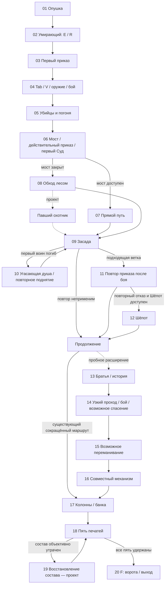

# Sinbinder — полная спецификация сна-обучения

**Редакция:** 26.11.2026. **Назначение:** единая практическая спецификация для геймдизайна, построения уровня, реализации, UX и независимого QA. Не новый канон, не разрешение на расширение AOS, не акт приёмки.

**Проверенная база:** `feature/sinbinder-canonical-integration-unified-2026-11-25`, SHA `03c56ca337f447c24dada405198a704bcccac5dc`. Сверены №68, №69 (§5, §11.1, §11.15, §16–20) и ключевые ветви `DreamTutorialDirector.cs`. Исторические результаты тестов перенесены с явной оговоркой; Unity в ходе составления этой спецификации не запускалась. PR #22 о родстве не входит в проверенную базу.

## 0. Как читать документ

- **[РЕШЕНО]** — авторское требование; не менять самовольно.
- **[КОД]** — обнаруженный путь в существующем исходнике; не доказательство корректности всех веток.
- **[ПРОЕКТ]** — предложенная постановка или контракт, включая согласованное направление пробного маршрута, но не принятые окончательные детали.
- **[ПРОБЕЛ]** — отсутствующая, спорная либо непроверенная часть; не объявлять реализованной.
- **[ПРИЁМКА]** — наблюдаемый результат и необходимая проверка.

При противоречии применять более позднее явное решение автора, а не старую отметку в журнале. №68 остаётся источником исходной географии, №69 — реестром работ и авторских решений. Эта спецификация уточняет их совместное чтение. Никакая иллюстрация или схема не переопределяет текст.

## 1. Цель и границы

[РЕШЕНО] Сон — первый полноценный игровой опыт, близкий по структуре к прологу Орды Warcraft III и первой области Overlord (Спелые холмы), а не длинная лекция или набор изолированных комнат. Игрок получает отряд, сталкивается с его самостоятельностью, действует вместе с воинами, изучает их личности и применяет знания в финальной задаче. Не копировать чужие карты, сюжет или интерфейс. Не вводить строительство базы, новые голоса AOS или отдельную учебную модель принятия решений.

Главный результат: игрок на собственном опыте отличает приказ от исполнения, понимает, что мотивы зависят от личности и обстоятельств, знает способы влиять на решение и способен подобрать состав для пяти печатей. Все обязательные уроки должны быть объяснимы без внешнего руководства. Не требовать обязательного спасения, предательства, переманивания, согласия или отказа конкретного воина.

### 1.1 Что переносится в обычную игру

- Тактическое управление, первое лицо, режимы Командира и Воина.
- Души, банки, оболочки, силы, поднятие, бой, блок, приказы, память, отношения, Шёпот.
- Пригодность конкретных личностей для механизмов, физическое участие, независимый выбор AOS.
- Осмотр воинов и объяснение решений через Суд и связанные подсказки.
- Необязательные загадки и исследование в личных экспедициях. Подходящий состав не гарантируется за пределами обязательного учебного испытания.
- Лагерь и первые экспедиции развивают экономику и самостоятельное применение освоенного; не превращать сон в обучение всем подсистемам сразу.

### 1.2 Канон Бога Смерти

[РЕШЕНО] Восемь безымянных Первородных Греховодов созданы Богом Смерти из почти разложившихся душ, не подверженных изначально влияниям, кроме верности. Они инструменты, обязанные повиноваться. Их задача — очистить мир от жизни. Поднятие нежити — промежуточный этап, основанный на унаследованной части Его силы. Смерть исполнен тихого гнева и желания мести всему живому, презирает жизнь. Не философ, не добрый учитель, не сторонник свободной воли.

Смерть говорит краткими приказами, не называет клавиш, мышь, режимы, шкалы, UI. Не хвалит милосердие, не обещает чужого подчинения. Помощь живому допустима только по смыслу инструментальной задачи; не приписывать Смерти сочувствие. Часть этапов проходит без Его слов. Сохранять утверждённые сюжетные реплики. Новые строки согласовывать отдельно.

[КОД] DeathCue: «Забери душу.», «Отдай приказ.», «Опусти мост.». Плашка отдельно содержит техническое действие; источник звука DeathVoice.UtterLesson. Голос отменяется при смене этапа или закрывающем режиме. Фактическое качество синтеза и слышимость не приняты.

## 2. География, топология и порядок

[РЕШЕНО] Сохранить исходную карту №68 и её смысл: опушка, дорога, умирающий, стоянка убийц, развилка, мост с рычагом, засада за рекой, лесной обход, расщелина, бревно, колонны, площадь печатей и ворота. Озеро остаётся элементом среды, отдельная обязательная загадка там не согласована. Старые форт и двор с камнем не возвращать ради наполнения. Чучело пока сохранить, пока реальный урок удара и блока не доказал полноценную замену.

### 2.1 Исторические координаты №68 (Unity x,z)

Это разметка №68 от 19.11, **не новая измеренная геометрия текущей сцены**; перед размещением сверить DreamRoadMap/DreamRoad и сцену.

| Зона | Координаты/ориентир | Назначение |
|---|---|---|
| Опушка | (-121; 29) | Старт, круг камней |
| Умирающий | (-107; 29) | Первый сбор и поднятие |
| Стоянка убийц | (-84; 31,5) | Первое лицо, бой, встреча |
| Развилка | (-70; 29) | Мост или лес |
| Мост | (-57; 29) | Настил, рычаг на восточном берегу |
| Засада | (-32; 11) | Поляна, бой |
| Лес | Серпантин | Обход реки и озера |
| Бревно | (-21; -24) | Расщелина, проект совместной переправы |
| Колонны | (-12; -24) | Камень с банкой, жаровня |
| Пять печатей | Конец учебного пути | Пять позиций, ворота |

### 2.2 Основной граф

Засада предшествует повтору приказа. Лесной обход условный, а не обязательный для каждого прохождения. Шёпот условный. Эпизоды 13–16 — пробное расширение, не существующие обязательные стадии. Необязательные ответвления могут размещаться в лесу, у стоянки, руин и после боя, но не за последними воротами как условие выхода. Возврат на основную дорогу и короткие пути важнее новых пустых километров.

### 2.3 Пространственная постановка (проект)

- Старт видит ближайший ориентир, но не раскрывает всю карту. Умирающий лежит у естественного прохода.
- Стоянка и убийцы читаются заранее; мост имеет видимые берега, настил и рычаг. Игрок должен понимать, кто может физически добраться до рычага.
- Развилка ясно показывает сухой лесной обход, не ведёт маркером через закрытый мост или воду. Засада достижима с обеих веток.
- Братьев желательно встретить до площади, чтобы финальная загадка проверяла знание, а не знакомила с ним впервые. Конкретное место, состав резерва и способ встречи требуют постановки.
- Узкий проход и боковой путь различимы; пространство боя допускает укрытие, отход и помощь раненому, а не принудительное событие на таймере.
- Механизм расположен перед колоннами и проверяет одновременное действие двух воинов. Предлагаемое место — расщелина/бревно либо ворот. Точные действия, позиции и альтернативы не утверждены.
- У колонн безопасный читаемый участок для взаимодействия с банкой. Площадь отделена от боя достаточно, чтобы игрок мог осмотреть отряд и решить загадку.
- Пять печатей физически различимы, у каждой собственный знак и обратная связь. Подходы не перекрывают друг друга, навмеш допускает пять участников одновременно.
- Секреты — короткие карманы с выходом обратно, не длинные обходы ради обязательной награды. Конкретные награды и история реликвий требуют решения автора; Memory Director не входит в текущий ремонтный спринт.

## 3. Управление и правила подсказок

| Действие | Требование |
|---|---|
| Tab | Тактический вид сверху ↔ первое лицо. |
| V | Только первое лицо: Командир ↔ Воин. Камера не переключается. |
| ЛКМ / ПКМ сверху и в первом лице Командира | Выбор / контекстный приказ; ПКМ по земле перемещает соответствующего адресата, не гарантирует выполнение. |
| ЛКМ / ПКМ в первом лице Воина | Атака / блок. |
| WASD | Передвижение в первом лице, в том числе при входе на своё место в первом Суде; сверить фактический режим. |
| Колесо | Камера тактического режима по №68. |
| B | Обнажить оружие, только при наличии соответствующего Armament; посох не требует лишней стадии. |
| E | Контекстное взаимодействие/сбор души/банки. Сбор души только Греховодом. |
| J | Выбор банки в суме (текущий учебный шаг). |
| R | Контекст: взять выбранную банку в руку, вернуть душу в тело в допустимом сценарии. |
| Z | Шёпот, не отмена действия. |
| U / Shift+U | Ручной просмотр Суда / полный вариант по №69; точную реализацию проверить. |
| F | Ворота после открытия печатей. |

[РЕШЕНО] Плашки, стрелки и актуальные клавиши повсюду, где необходима помощь. TaskList — что, Lesson — как, PlaceMarker — где. Маркер ведёт по доступному маршруту, не раскрывает скрытые цели, исчезнувшего персонажа, готовое решение загадки. При смене цели/режима удаляется устаревшая подсказка. Одновременно одна главная инструкция; дополнительные только по контексту. Не перекрывать Суд, паузу, диалог и модальные панели. Разрешённый обход и добровольное исследование не считать неповиновением маршруту.

[РЕШЕНО] При отклонении от допустимого маршрута Смерть может перехватить управление; точные триггеры и постановку сохранить по авторскому сценарию, не расширять произвольно. [КОД] PermitDestination/PermitWalking ограничивают движение в сне, учитывают _handBusy, Behind, OffRoute, _backAttempts и AheadLimit. [ПРОБЕЛ] Совместимость с новыми ответвлениями, восстановлением состава и обеими формами управления требует проверки. Никакой новой шкалы подчинения; не двигать курсор ОС и не применять учебные ограничения в иных сценах.

## 4. Поэтапный сценарий: вход, действия, исходы, завершение

В колонке «Плашка» указана **предлагаемая нейтральная инструкция**, если явно не отмечен текущий текст. Не является разрешением заменить существующие RU/EN строки. Условие завершения означает желаемое проверяемое событие, а не любое нажатие клавиши. Технические состояния ожидания, пропуска и недоступности должны записываться отдельно от освоенного урока.

### T01 — Опушка (Approach)

- Вход: новая игра, сон, персонаж и камера готовы; контекстная задача, стрелка к умирающему, видимый путь.
- Действия: движение, наблюдение камеры и дороги. Плашка: «ПКМ по земле — идти. Следуйте к умирающему». Смерть молчит, если не предусмотрена утверждённая вступительная реплика.
- [КОД] Подход на 4,8 м запускает Dying или Harvest, если уже мёртв.
- Завершение: фактическое достижение зоны, а не клик по цели.
- Проверки: Tab туда/обратно, попытка идти за пределы, возврат, пауза, не блокировать доступную дорогу.

### T02 — Умирающий и смерть (Dying)

- Игрок обнаруживает незнакомца, слушает существующий диалог. Факт сцены: двое убийц оставили его у дороги. Личность может различаться между прохождениями; фиксированное событие не означает фиксированный выбор.
- [КОД] Текущая генерация seed зависит от счётчика снов на ПК; диалог начинается при подходе; переход при фактической смерти.
- Плашка: «Выслушайте умирающего». Маркер тела. Смерть не пересказывает историю.
- Проверки: ранний подход, повтор, диалог пропущен/закрыт, труп уже существует; одна и та же смерть не создаёт две души.

### T03 — Сбор души (Harvest)

- Вход: незнакомец действительно умер, существует доступная душа и допустимое место сбора.
- Плашка текущего кода: «Подойди к душе и нажми E. Свежая душа сохраняет память.» Смерть: «Забери душу.»
- Правило: физическое получение конкретной души в конкретную банку, сохранить идентичность, состояние распада, память по действующим правилам. Сбор только Греховодом.
- [КОД] Переход при FindJar() >= 0; спустя 50 с код присваивает _fallbackSoul = _wounded.Soul и переходит к R даже без сбора.
- [ПРОБЕЛ] FindJar должен относиться к требуемой душе, а не любой банке; fallback нельзя выдавать за штатную жатву. Решить честное учебное восстановление, не создавать лишнюю душу.
- Завершение: подтверждённая конкретная душа в банке или отдельно отмеченное законное восстановление. Проверки: занятая сумка, другая душа в банке, неверная цель, повтор E, угасание, отсутствие двойного владения.

### T04 — Первое поднятие (Rebind)

- Плашка: «Подойдите к телу. R — вернуть душу в оболочку». Маркер точного тела. Возможная реплика «Подними мертвеца» пока черновик.
- [КОД] R в радиусе менее 4 м от _woundedAt вызывает TryRebind; урок имеет специальные пути.
- Завершение: существует один новый управляемый воин из той же конкретной души; исходное владение и оболочка согласованно изменены.
- [РЕШЕНО] Боевое поднятие по §20 требует весь запас сил и 1 HP. Не распространять автоматически на первое небоевое поднятие или стационарный склеп; точную цену и учебные исключения согласовать.
- Проверки: неправильная банка, недостаток сил в применимых режимах, недопустимое тело, повтор R, ошибка создания, смерть сразу после поднятия, сохранность 7 спектров, уровня, биографии, родства и ID.

### T05 — Первый приказ (Command)

- Плашка: «Выделите воина ЛКМ. ПКМ по земле — приказ идти. Исполнит ли его воин, решает душа». Смерть: «Отдай приказ».
- [КОД] OrderedSinceMark отличает приказ воину от движения самого Греховода. После обнаружения выдаётся строка «Воин услышал приказ. Посмотрите, как он ответит.» Через 3,5 с после приказа, либо 20/60 с ожидания без приказа, код начинает сопровождение и следующий урок.
- Завершение целевого урока: команда действительно адресована воину; отдельно наблюдается результат. Тайм-аут может продвинуть сценарий, но помечает урок пропущенным, не выполненным.
- Проверки: свой/чужой, групповая команда, пустой выбор, смена цели, отказ, колебание, исчезновение цели, задержка пути, повтор без ложной памяти.

### T06 — Tab, V, оружие (FirstPerson / WarriorMode / DrawWeapon)

- Плашки: «Tab — взгляд от первого лица», затем «V — режим Воина», затем при наличии Armament «B — достать оружие».
- [КОД] Первая стадия ждёт FirstPersonNow, следующая WarriorModeNow; B только при необходимости. При посохе переход к практике.
- Завершение: правильное фактическое состояние, не факт нажатия кнопки. Если игрок вышел в тактику или сменил роль, подсказка должна восстановить нужный режим: Tab из тактики, V только внутри первого лица.
- Проверки: обе стороны Tab, повтор V, ошибочное нажатие V сверху, управление мышью в обеих ролях, смена при паузе/Суде, не менять камеру на V.

### T07 — Реальная атака и блок (Practice)

- [КОД] Чучело у дороги; учитываются DummyHits, DummyRipostes, DummyBlocks; взмах в воздухе не равен попаданию. При двух промахах даётся инструкция приблизиться и направить взгляд; завершение после встреченного блока.
- Плашка: «ЛКМ — удар по цели; удерживайте ПКМ, когда цель отвечает». Стрелка к чучелу либо проверенному боевому участку.
- [ПРОЕКТ] Перенести урок в короткую безопасную боевую ситуацию после подтверждения эквивалентного обучения. Не удалять чучело до этого.
- Проверки: промах, недостающая выносливость, оружие не обнажено, неверная роль, блок без атаки, реально заблокированный удар, уход и возврат. Никакого фиктивного зачёта.

### T08 — Встреча убийц и погоня (Standoff / Chase)

- Событие: убийцы узнают поднятого, бегут к мосту и засаде. Мотив мести может проявиться через реальную память, но герой не обязан гнаться.
- [КОД] Standoff вызывает Flee после 3,2 с; ветка NOCHASE предусматривает приказ догнать и Суд. Исторический №68 описывает поднятие моста после проскока или задержки при отсутствии людей над рекой.
- Плашка: фактическая ситуация — «Следуйте к мосту» либо «Он не гонится. Выделите воина и прикажите догнать убийцу ПКМ». Не утверждать мотив Гнева, если не подтверждён.
- Завершение: убийцы ушли к следующему участку, судьба приказа установлена или честно недоступна.
- Проверки: погнался/не погнался, приказ выполнен/отклонён/завис, воин погиб раньше, убийца недоступен, игрок опередил поднятого, переход к мосту без потери решения.

### T09 — Мост, рычаг, конфликт мотивов (Bridge / Deciding)

- Мост поднят, воин может оказаться на другом берегу, рычаг доступен только при физическом подходе. Игрок даёт приказ опустить мост; приказ издали имеет фактическое влияние по существующей механике слышимости.
- Смерть: «Опусти мост» только при соответствующем реальном контексте. Плашка: «Выделите воина и ПКМ по рычагу». Стрелка к рычагу, а при движении героя — к доступному пути.
- [КОД] Если игрок медлит, через 14 с либо 45 с при Lesson.Holding скрипт может выдать приказ сам. Deciding фиксирует CommandRevision, при задержке вызывает mind.Decide(), после 6 с без решения переходит к бою без Суда. Это текущий сценарный fallback, не норма общей AOS и не выполненный игроком урок.
- [РЕШЕНО] Рычаг не срабатывает от намерения или стояния рядом до приказа; действие должен выполнить допустимый участник. При отказе доступен обход.
- Завершение: решение связано с текущей ревизией приказа; мост открывается только при фактическом действии. Отдельно записать согласие, отказ, колебание, собственную инициативу, отсутствие решения, вмешательство скрипта.
- Проверки: смена приказа в тот же кадр, чужая цель, персонаж уже у рычага, прибытие без решения, гибель/смена стороны, отсутствие навмеша, оба берега, переход мостом после открытия.

### T10 — Первый полный Суд души

- [РЕШЕНО] Первый Суд показывает, что приказ Греховода — только один аргумент среди существующих 13 голосов. Игрок занимает своё место судьи; цель — увидеть настоящее решение, а не заранее написанную сцену о Гневе.
- [КОД / исторический №68] Тьма, место «Ваш приказ», ходьба к нему (WASD); дальность места отражает громкость приказа; настройка CourtWalk и пропуск Esc. Исторические автоматические таймеры подхода не считать обязательным мастерством.
- [РЕШЕНО] После полного Суда показать короткий пример, перед ним предоставить выбор показа Суда в важных ситуациях; ручной U сохраняется при отключении автоматического показа. Полный ручной вариант Shift+U по №69. [ПРОБЕЛ] Достижимость настройки и всех веток на текущей базе проверить, не обещать наличие короткого Суда на каждой ветке.
- Вход: исторический снимок конкретной души, приказа, кандидатов, 13 голосов, внешних модификаторов, весов, итогового решения и фактического события исполнения. Не использовать нынешние HP, мораль или новый приказ вместо исторического состояния. Различать отсутствие/воздержание голоса, колебание и отказ. Не называть самый громкий голос доказанной причиной без контрфактической проверки.
- Плашки: сначала вопрос «Послушается?» (проект №68, фактическое наличие проверить); затем подсказка к месту; техническая настройка отдельна от лора.
- Завершение: игрок видит вердикт и понимает его связь с наблюдаемым поведением; сам Суд не меняет голосование и не исполняет приказ.
- Проверки: послушание, отказ, колебание, совпавшее независимое действие, внешние модификаторы, две необходимые причины, смена приказа/характера во время ожидания камеры, повтор U, отключение автопоказа, Esc, RU/EN, отсутствие двойного события. Замер длительности вручную, не подменять автоматическим прогоном.

### T11 — Прямой путь или лесной обход

- Если мост физически открыт, доступен прямой путь. Если закрыт и пройти нельзя — лесной серпантин ведёт к засаде. Не требовать обход при успешном открытии и не считать обход провалом.
- [ПРОЕКТ] Павший Охотник в лесу — дополнительный доступный воин по №68. Сбор и поднятие должны идти штатным путём и сохранять конкретную личность. Не гарантировать его поднятие или послушание одной кнопкой.
- Плашка: «Мост поднят. Обойдите реку лесом» только при закрытом пути. Находка — отдельное контекстное действие.
- Проверки: доступность обоих маршрутов, открытие моста в ходе обхода, возврат, смерть первого воина, неверная стрелка, разрешённые исследовательские карманы, нет невидимого барьера на допустимой тропе.

### T12 — Засада и участие игрока (Battle)

- Столкновение с убийцами и засадой. Игрок выбирает способ участия: лично в режиме Воина, командованием, приближением и помощью. Не выдавать присутствие без фактической помощи за спасение.
- [КОД] Battle вызывает KeepHeroAlive, ArmArrived, WatchLord. При гибели первого поднятого переходит в Fallen. После гибели убийц живой воин с refused может записать память и открыть Retest; иначе переход к Jars. KeepHeroAlive — специальный учебный обход, который нужно отдельно проверить/согласовать, не объявлять общей боевой механикой.
- Историческая модель Remember: при заданных условиях LordCame/LordAbsent, +10/-15 верности, запись один раз. Важна реальная причина; близость к засаде — не доказательство защиты. Перепроверить источник и владельца памяти, реальную применимость к послушавшемуся/колебавшемуся.
- Плашка: «Отбейтесь от убийц», при закрытом мосте — указатель обхода. Смерть может сказать «Уничтожь их» только по утверждённой постановке.
- Завершение: реальные боевые события; память соответствует тому, что произошло, без искусственной заслуги.
- Проверки: пришёл/не пришёл, пришёл после гибели, помог другому, сам убил врага/убил союзник, убийца умер вне знания воина, смерть и повторное событие, отход, отсутствие фантомного врага.

### T13 — Ветка «опоздал» (Fallen / LATE)

- Вход: первый поднятый действительно погиб; душа угасает у тела. Игрок может собрать E и вернуть R до угасания, либо продолжить без него, если он утрачен.
- [КОД] Fallen вызывает Reraise при R в пределах 4 м от _lateAt; при отсутствии банки и угасании переходит обратно к бою. Точная адресность FindJar, идентичность и владение требуют F03/F04/F06/F25.
- [РЕШЕНО] После §20 боевое поднятие стоит 100% максимума сил (рабочее толкование) и даёт ровно 1 HP после окончательной инициализации; лечение — 50% максимума, небольшая величина пока не определена. Не скрывать бесплатное восстановление HP ради прохождения сна.
- Плашка: «Душа угасает. E — собрать. Для поднятия нужны силы» с точной клавишей и доступностью по реализации. Если недостаточно сил — честная причина и возможность отойти/восстановиться; не считать это отказом души.
- Завершение: один поднятый с корректным HP/личностью и списанием, либо подтверждённая утрата. Не блокировать дальнейший обязательный путь одной безвозвратной потерей состава.
- Проверки: 0/49/50/99/100%, расход движения перед действием, повтор R, плохая оболочка, отсутствующая банка, ноль HP, потеря обоих братьев позднее, отсутствие дублирования.

### T14 — Повторный приказ после боя (Retest)

- Применяется, когда есть живой первый воин и подходящее ранее решение, а исходный конфликт у моста изменился. Тот же рычаг, уже без убийц.
- [КОД] Retest ждёт свежую ревизию, при задержке повторно вызывает Decide один раз; после 6 с без решения регистрирует отсутствие решения; без приказа и без удержания Lesson может завершиться через 40 с. Contrast не утверждает, что исчезновение убийц доказанно изменило единственный голос.
- Плашка: «Убийц больше нет. Отдайте тот же приказ ПКМ по рычагу». Если цель мертва или путь недоступен — честно пропустить пример.
- Завершение: второй исторический бюллетень относится к новой ревизии, сравнимы обстоятельства и действие. Разный ответ возможен, не обязателен. Короткий Суд/сравнение должно опираться на факты.
- Проверки: тот же/другой ответ, другая решающая причина, отсутствие решения, приказ отменён, новое событие и исходный снимок, не выдавать совпадение за подчинение.

### T15 — Шёпот (Whisper)

- Условная ветка после отказа/колебания, когда жива конкретная душа, текущий приказ и законная возможность Шёпота существуют.
- [КОД] Contrast проверяет Whisper.Can/CanIfCloser. Подойти и Z; исторически Reach 12 м, мост разделяет на большую дистанцию. При уговоре возможен фактический путь к рычагу, при отказе или отсутствии действия продолжается путь к колоннам.
- Плашка: «Подойдите к воину. Z — шепнуть его греху» только если действие доступно; текст предложения соответствует фактическому греху/цене.
- Не превращать временный уговор в верность или изменение исторического бюллетеня; применить только к согласованной ревизии приказа. Не списывать за отменённое предложение, повтор, смерть, смену стороны или уже неактуальную цель.
- Проверки: доступен/недоступен, цена, согласие/отказ/колебание, смена приказа во время диалога, недостаток ресурсов, расстояние, обе формы управления, результат не равен обещанию. Не растягивать дальность специально ради моста.

### T16 — Знакомство с двумя братьями (проект)

- [РЕШЕНО] Генератор гарантирует два конкретных связанных ID, отдельного Гневного и отдельного Охотника Ордена. Родство узнаваемо через историю, реплики и карточку отношений, не по совпадению имени/перка. Гарантия состава не означает гарантии сотрудничества.
- [ПРОЕКТ] Встретить братьев до финальной загадки; показать хотя бы один доступный игроку факт родства. Одна сцена может совместить знакомство, опасность и спасение. Не придумывать окончательные имена, биографии и место встречи без авторской постановки.
- Плашка: «Осмотрите воинов и их известные отношения» без готового ответа о печатях. Вкладка отношений — только известные Греховоду сведения, источник и направление, не всеведение.
- Завершение: факт родства доступен через реальные данные; отдельный исход помощи/непомощи. Тест: одноимённые чужие, одноимённые пары, разные ID, смерть и возвращение, перк «брат» без реальной связи, потеря одного или обоих, повторная загрузка.

### T17 — Узкий проход, бой и возможное спасение (проект)

- Не серия четырёх одинаковых боёв. Компактный участок с узким проходом, обходом и опасностью для товарища. Можно держать позицию, атаковать, обходить, прикрыть раненого, лично помочь, отступить.
- [КОД] №69 §17.5 фиксирует узкое исправление адресности SaveAlly: 3D цель — конкретный критически раненый, по имеющимся порогу 30% и радиусу 10 м; исполнитель не должен подменять цель. Это не готовая сцена спасения. Автоэкспедиция имеет другую модель; абстрактное лечение не считать перехватом удара в 3D.
- Плашки зависят от актуального состояния: «Удерживайте проход» / «Есть обход» / «Воин ранен» только при фактах. Не обещать, что брат спасёт брата.
- Завершение: доступный дальнейший путь после фактического результата боя/обхода; спасение необязательно. Память привязана к тому, кто и кого спас; отказ допускается, не генерируется скриптом.
- Проверки: два раненых с разными связями, цель ушла/погибла/выздоровела/сменила сторону, враг только рядом, ложная угроза, реальная защита, взаимная неприязнь, смена приказа, обе ветки и нет softlock.

### T18 — Переманивание и предательство (проект)

- Бандит под угрозой Ордена: игрок может помочь, атаковать, пройти мимо; при законной доступности — предложить переход. Благодарность не равна согласию вступить, временное прекращение вражды не равно постоянной верности.
- Живой Охотник, продолжающий службу Ордену и охоту на Греховода, не кандидат на вступление; поднятый бывший Охотник — отдельная ситуация. Нельзя автоматически приравнять Trade к текущей принадлежности или одинаковый Team.Enemy к союзу.
- Предложение: адресный факт, допустимость, реальные ресурсы и обстоятельства; решение цели существующими 13 голосами; повторная проверка условий; изменение стороны/приказа/целей/реестра и память лишь при подтверждённом исполнении. Отдельные исходы: отказ, колебание, уход/нейтралитет, вступление; временный союз — проект, требует согласования.
- Предательство возможно в обе стороны, но не обязательный исход и не способ гарантированно получить нужную печать. Не вводить бесплатное вступление при каждом спасении. Плашка и реплики отражают реальное предложение, голосование и фактический переход.
- [ПРОБЕЛ] Есть BribeEnemy/AcceptBribe и части исполнителей/событий, но полной достижимой цепочки 3D/авто не доказано. До внедрения проверить F08/F11/F13/F14/F15/F21; не делать новую систему в обход текущего AOS-спринта.
- Проверки: спасение не было, угроза не личная, другой убийца, нет свидетеля, одинаковый тег врага, действующий Орден, недостаток денег, смерть/уход, отказ/колебание, повтор, сохранение, отмена команды, обе стороны. Выход из участка независимо от результата.

### T19 — Совместный механизм (проект)

- Вариант: бревно через расщелину или ворот под угрозой, два разных воина одновременно выполняют свои роли. Физическая доступность и пригодность отличаются от желания; дружба не гарантирует работу, вражда не скриптует провал.
- Плашка: «Назначьте двух воинов к механизму»; маркеры двух реальных позиций; наблюдаемая обратная связь каждого участника. Конкретные позиции, длительность и способ освобождения механизма — постановка на утверждение.
- Завершение: физическое изменение объекта после подтверждённых действий. Один воин не считается за двоих. При уходе/смерти/отмене прерывается удержание. Возможность заменить участника или законно восстановить состав; альтернативный путь — если не лишает урока и согласован.
- Проверки: отказ одного, колебание, неподходящая душа, оба на одной позиции, отмена, смерть, прерывание ударом, повтор, блокировка пути, воины с общей историей, итог не зависит от одного таймера ожидания. Сначала TestChamber.

### T20 — Колонны и банка (Jars)

- [РЕШЕНО] Камень с банкой — настоящее взаимодействие: взять E, выбрать J, взять выбранную банку с душой в руки R; затем идти к воротам. Не требовать вернуть её в суму только ради лишней кнопки.
- [КОД] Stage.Jars: NearShrine, E, Satchel.AddJar, Fill с учебной душой, TakeSoulJar, выбор _jarIndex, CryptHands.Empty. При полной суме код сразу идёт к воротам. Проверка непустой руки сама по себе может не удостоверять нужную банку.
- Плашки по очереди: «E — забрать банку в суму»; «J — выберите эту банку»; «R — возьмите её в руку». Стрелка к камню, затем контекстный индикатор выбранной банки.
- Завершение: именно взятая с камня душа/банка в руках, либо честно зарегистрированная невозможность/согласованный пропуск. Не зачесть другую банку. Никаких дубликатов, потери содержимого или незаявленной награды за повторный E.
- Проверки: полная сумка, руки заняты, другая банка выбрана/в руках, двойной ввод, уход/возврат, отсутствие камня, фактическое состояние после перехода.

### T21 — Пять печатей (Return / Seals)

[РЕШЕНО] Финальный экзамен требует четырёх подходящих разных воинов и самого Греховода. Игрок должен понять отряд или осмысленно проверить гипотезы. Не выдавать готовый ответ в общей стрелке/плашке; информация о характере и родстве доступна при осмотре.

| Печать | Требование автора | Текущая реализация |
|---|---|---|
| Венец | Греховод лично | OnSeal(hero, LordSealAt) |
| Меч | Гневный воин | доминирующий Wrath и значение >=25 по записи №69 §11.15; точный баланс не принят |
| Сцепленная левая | Один из пары братьев | живой активный Team.Player, Kin; пара проверяется совместно |
| Сцепленная правая | Другой брат | другой Soul.Id и тот же непустой Kin |
| Крест | Охотник Ордена | Trades.OfOrder; расширение на все чины требует решения автора |

[КОД] Seals: SpawnFallen один раз; DreamGuards.Make гарантирует набор по документированному контракту; есть четыре роли и пятый резервный страж по §11.15. Одна фигура занимает одну печать; чужой/мёртвый/неактивный не подходит. Раздельные братские индикаторы, частичный свет для одиночного брата, полный при настоящей паре. AdvanceSeals требует все пять одновременно в течение 1,2 с. После фактического открытия можно перейти к F. Проверить реальные границы и физические позиции, не выводить скрытые числа игроку.

[КОД] E рядом с павшим вызывает RaiseFallen, напрямую Raising.Rise(body.Soul, ...); исходное тело отключается после успеха. Это специальный учебный путь, не доказательство соблюдения новой цены, правильной жатвы и жизненного цикла во всех режимах. Встреча с братьями здесь уже возможна через подсказки после поднятия; раннее знакомство T16 остаётся проектом.

Плашка: «Ворота ждут пятерых. Осмотрите печати и воинов». При подходе показать свой знак и смысл условия, не выделять автоматически подходящую конкретную душу. При неверном участнике — наблюдаемое отсутствие активации, не штраф за попытку. При фактическом отказе конкретной ревизии допускается авторская реплика о воле; при задержке нейтрально предложить другой способ.

Проверки: верный состав; Гнев с неправильным доминирующим спектром; чужой на мече; Охотник не в той роли; родство по имени, перку, одинаковому ID; только один брат; перестановка братьев; две фигуры на одной печати; умерший/предавший; выход одной фигуры до 1,2 с; повтор; прерванный путь; задержка не названа отказом; нет открытия без всех пяти.

### T22 — Восстановление состава (проект §17.2)

Наличие подходящих личностей гарантируется только для обязательного сна. Доказательство невозможности — не таймер, не отказ, не колебание и не плохой выбор плиты. Требуется проверить всех известных живых, доступные тела, ещё не угасшие души, банки, руки, законный путь восстановления и существующий резерв. Найти непересекающееся назначение четырёх разных ID, включая настоящую пару.

1. Штатный сбор/поднятие доступной души с её ID и состоянием.
2. Использование существующих подходящих павших/живых, включая реальную пару.
3. Только при объективной невозможности — проект локального вмешательства Смерти у площади: восстановить ровно недостающие души для штатного поднятия, а не выдать готовых послушных воинов или открыть ворота. Конкретное место, цена, реплики, состояние памяти при угасании не утверждены. Не копировать тело/душу/ресурсы и не восстанавливать уже доступную душу.
4. Если невозможно безопасно восстановить состояние, проект альтернативы: повтор только испытания с контрольной точки, отдельно согласовать.

[ПРОБЕЛ] №69 §11.15: уровни 1 и 3 не реализованы как полноценное восстановление испытания; имеется резерв стражей. Не считать текущий E достаточной приёмкой.

Проверки: погиб один/оба брата, Гневный, Охотник, все; душа в руке/банке/у тела; законный отказ; путь временно закрыт; дубликат ID; резерв исчерпан; повторная утрата; сохранение/загрузка; NOCHASE/LATE; нет фарма и переноса ресурсов сна в обычную игру. После помощи снова решается настоящая загадка.

### T23 — Ворота, выход и переход в лагерь

- Вход: печати физически открыли ворота. [КОД] Stage.Return ждёт NearGate или OnSeal(hero, LordSealAt) и F, затем Crypt().
- Плашка: «Ворота открыты. Подойдите и нажмите F». Маркер к доступному выходу. Возможная реплика Смерти только по канону, без нового сюжетного текста.
- Завершение: штатный переход сна, корректный вход в следующую часть игры, очищены учебные подписки/маркеры/звук/временные ограничения, не переносятся ложные награды и специальные учебные состояния.
- Проверки: F до открытия, многократное F, смерть/пауза/Суд при переходе, повтор новой игры, состояние камеры/Tab/V, первая подсказка лагеря не израсходована во сне, ресурсы и личность по утверждённому сценарию перехода.

## 5. Необязательные ответвления и секреты

[ПРОЕКТ] Короткие карманы исследования: у опушки/стоянки, в лесу, у руин, около боевого участка. Конкретные число, размещение, награды, сюжет меча/реликвии и судьбы братьев не утверждены. Не делать тайник обязательным ради пяти печатей. Не обозначать неизвестный секрет стрелкой главной цели. Игрок может заметить след, исследовать, уйти и вернуться доступным коротким путём. Не заменять основные уроки необязательной находкой. Не добавлять Memory Director в ремонтный спринт §19.

[РЕШЕНО] В обычных экспедициях секрет может требовать состава, которого сейчас нет. Запомнить известное место и условие; вернуться другим составом в реальное состояние мира. Не перегенерировать добычу и погибших, не подстраивать души под каждую загадку. Это правило не отменяет гарантию решения обязательной учебной площади.

## 6. Общий технический контракт: никаких специальных фиктивных результатов

- Учебный директор организует этап, доступную географию и подсказки; решения воинов принадлежат существующей AOS. 13 голосов, реальные перки, эмоции, память, отношения, происхождение, факт события.
- Для каждой команды: адресат, устойчивый ID, CommandRevision, цель, контекст, фактическая доступность. Развести issued, pending, natural verdict, attempted, interrupted, completed. Ожидание не отказ. Решение не исполнение. Шёпот не естественная лояльность.
- Суд и реплей используют неизменяемый исторический след, не пересчитывают прошлое по текущему контексту. Учитывать реальные внешние модификаторы и не скрывать отсутствие доказательства причины.
- Смерть, тело, душа, банка, рука, поднятие, отряд и сохранение образуют один непрерывный путь. Не использовать имя вместо идентичности. Не терять семь спектров, уровень, биографию, перки, родство, память и отношения без законного правила распада; не применять смещение ремесла повторно. Поздняя потеря памяти/родства — не повод самовольно менять канон.
- Все операции ресурсов и владения атомарны, повторная обработка не создаёт дубликат. Не вычитать энергию при неуспехе. Не вводить отдельную ману. Полное HP стационарного связывания в склепе сохраняется; его цена отдельно не утверждена.
- Контекстный UI: правильная роль, реальная клавиша, видимая/известная цель, точный исход, локализация RU/EN. Достоверность текста важнее количества реплик.

### 6.1 Проверенные точки исходника и технический долг

| Путь | Наблюдение на проверенной базе | Что требуется |
|---|---|---|
| Gameplay/DreamTutorialDirector.cs:43, 735–1035 | 20 существующих стадий, от Approach до Finished; нет отдельных стадий расширенных боевых уроков | Не выдавать T16–T19 за реализованные |
| :206–239 | DeathCue и отмена озвучки | Проверка слышимости, паузы и смены цели |
| :396–440 | PermitDestination/Walking; счётчик снов/seed | Проверить разрешённые ответвления, обе камеры |
| :749–789 | FindJar, fallbackSoul, тайм-аут первого приказа | Адресность души и честный пропуск |
| :801–846 | автоматический приказ, вызов Decide, ожидание | Наблюдать ревизию; не принуждать вердикт |
| :848–927 | KeepHeroAlive, Fallen, Retest | Пересмотр в соответствии с §20; проверка памяти и результата |
| :933–1029 | Tab/V/B, DummyHits/Blocks, банка | Реальные действия и актуальные режимы, точная банка |
| :1542–1612 | Remember и Contrast | Причинность и исторический след |
| :1968–2055 | Fits, Seals, KinPair, AdvanceSeals | Критерии пяти печатей и полная приёмка |
| :2134–2205 | SpawnFallen, RaiseFallen | Штатный контракт владения, HP/сил, восстановление |
| Core/Soul/SoulDecay.cs, Core/SaveGame.cs, Core/SaveSystem.cs | Жатва и SavedSoul теряют Kin в базовой версии | PR #22 — кандидат узкого исправления, не интегрирован |
| Tools/tutorial, Tools/aos | Существующие проверки исходников/шимы | Доказать чувствительность тестов, не выдавать за Unity |

Все строки относительны указанному SHA, при изменениях сверять заново. Полный инвентарь недостатков — архив R1–R21 и F01–F27.

## 7. Состояние, журнал и приёмка переходов (проект спецификации данных)

Не вводить новый runtime-класс только ради этой таблицы; использовать существующие структуры и дополнить лишь после согласования общего контракта F03/F04/F15.

Для каждого T01–T23 в проверочном журнале хранить: seed/вариант, ID шага, действительный режим камеры, ID персонажа и души, цель/ревизию, время появления и снятия подсказки, факт действия, состояние доступности, фактический исход, причина перехода, завершение/пропуск/недоступность, идентификатор Суда при наличии. Для механизма — участники и длительность реального удержания. Для операций души — владелец до/после, HP, силы до/после, отсутствие дубликатов. Для новых веток — реальное событие памяти/отношений; не записывать память при одном открытии UI.

Проверять отдельно: технически проходимо; урок выполнен действием; смысл понятен игроку. Не присваивать освоение по автопрогону, пропуску, тайм-ауту или сценарию, который сам выдаёт приказ. Любая аварийная ветка — явная, с конкретной причиной и без ложного вердикта.

## 8. Матрица обязательной приёмки

| ID | Проверка | Ожидаемое |
|---|---|---|
| QA-01 | Обычная ветка, мост открыт | Реальное действие у рычага, засада, дальнейший проход |
| QA-02 | Отказ у моста | Лесной обход, причина/действие совпадают |
| QA-03 | NOCHASE | Нет автоматического вывода о мотивах; настоящий приказ и доступный Суд |
| QA-04 | LATE, успел собрать | Конкретная душа, валидное поднятие, сохранение личности |
| QA-05 | LATE, душа угасла | Честная утрата, дальнейший маршрут, без ложного восстановления |
| QA-06 | Колебание/задержка пути | Не названы отказом; нет бесконечного ожидания |
| QA-07 | Повторный приказ | Два раздельных исторических решения; без выдуманной причины |
| QA-08 | Шёпот принят/отклонён/отменён | Законная цель, цена и действие; нет фиктивной верности |
| QA-09 | Первый полный и последующий короткий Суд | Реальный снимок и выбор автопоказа, ручной просмотр остаётся |
| QA-10 | Tab/V, Командир/Воин, B, попадание/блок | Актуальные подсказки, правильное действие в каждом режиме |
| QA-11 | Смена приказа во время Суда | Старый бюллетень сохранён, отложенное действие не подменяет новый приказ |
| QA-12 | Две независимые пары, одинаковые имена | Ни ложного родства, ни потери настоящего |
| QA-13 | Реальная помощь/непомощь/убийца другой | Адресная память, без фиктивной заслуги |
| QA-14 | Переманивание/предательство, обе стороны | Реальная доступность, голосование и исполнение; отказ проходим |
| QA-15 | Узкий проход и совместный механизм | Два реальных участника, корректное прерывание/замена |
| QA-16 | Полная сумка, другая банка, занятые руки | Не зачесть чужую душу, без дубликата или потери |
| QA-17 | Пять печатей, правильный состав | Все пять одновременно, 1,2 с, реальные ворота |
| QA-18 | Неверная печать, один брат, чужой, мёртвый | Ворота закрыты, обратная связь точна |
| QA-19 | Потери всех комбинаций состава | Законное восстановление только при объективной невозможности; нет фарма |
| QA-20 | 0/49/50/99/100% сил, ошибка, повтор | Атомарная цена, ровно 1 HP в бою, склеп full HP |
| QA-21 | Пауза/Суд/диалог/RU/EN/без звука | Нет устаревшей плашки и голоса; путь понятен без звука |
| QA-22 | Секрет, возврат, лес, отклонение | Разрешённые пути не блокируются; секрет необязателен |
| QA-23 | Повтор новой игры и загрузка применимых состояний | Нет старых ID, маркеров и учебных флагов в новой игре |
| QA-24 | F до/после открытия, вход в лагерь | Только законный выход, корректный переход |
| QA-25 | Ручной проход нового игрока и автора | Игрок объясняет волю, приказ, цену поднятия и печати; нет незакрытых P0/P1 |

У каждого исправления: базовый/целевой SHA, фактический исход, тест на старой ошибке, повтор на исправлении, конкретный production/asset, CI, Unity, независимая QA и авторская приёмка. Шим/статические проверки не равны Unity. При отсутствии инструмента — NOT_RUN/NEEDS_UNITY. Не закрывать пакет из-за зелёного CI без чувствительности теста.

### 8.1 Исторические свидетельства, не актуальная приёмка

№69 §11.15 фиксирует Tools/tutorial 145/145, 3000 seed стенда стражей, обычный Unity-прогон 6000.3.22f1 с воротами на 4:50 и нулём ошибок; NOCHASE/LATE вечером 25.11 на 494d8433 прошли без ошибок по записи. Первый Суд на старой площади ранее занял 173,3 с. Эти сведения — исторические отчёты, не результаты текущего запуска. 13–15 минут из №68 — старая цель длительности, а не подтверждённая продолжительность новой версии. Требуется ручной замер всех веток, включая время до первого значимого проявления AOS, длительность Суда, бой, решение печатей и добровольные ответвления.

## 9. Очередь внедрения и зависимости

1. **Текущий ремонт AOS §19**: F01 тесты, F02 перки, F03/F04 личность и идентичность; затем адресность целей и причинность. Не расширять механики ради сна.
2. Исправить фактические дефекты существующих уроков: T03–T05 адресность/зачёт, T09–T10 вердикт/действие/исторический Суд, T14–T15 повтор/Шёпот, T20 точная банка, T21 действительная пара.
3. §20 / F24: атомарные силы и 1 HP, лечение после решения величины; F25 владение и связывание. Проверить штатные пути до изменения сценария.
4. F06/F07/F08/F11–F15: родство, защита, достижимое предложение, реальные отношения сторон, голосование, исполнение, память, исторический Суд. Отдельный TestChamber с разными личностями и исходами.
5. F26: собрать пробный расширенный маршрут T16–T19, совместный механизм, гарантированный состав и восстановление T22; интегрировать без удаления старых веток до проверки.
6. UX: точные RU/EN, актуальные плашки/стрелки, редкий голос Смерти, читаемая карта. Затем ручные Unity-прогоны, независимый QA, автор.
7. Только после этого новые секреты/Memory Director или дополнительный босс по отдельному согласованию. Не считать весь список обязательством добавить контент немедленно.

Текущая автокоманда работает по F01–F27; не создавать параллельный конкурирующий спринт. №1 — AOS, №2 — экспедиции, №3 — UX/Суд/обучение, №4 — общие контракты/интеграция, №5 — независимый QA. Один владелец изменения, отдельный draft PR, no merge без решения автора; work-table не трогать.

## 10. Решения, которых ещё не хватает

| ID | Вопрос | Что не выбирать самовольно |
|---|---|---|
| D01 | Точная география расширения | Места братьев, опасности, тайников, боя и механизма; не переносить сцену по иллюстрации |
| D02 | Замена чучела | Какой реальный бой полноценно учит попаданию и встреченному блоку |
| D03 | Пятая печать | Только OrderHunter или все Trades.OfOrder |
| D04 | Порог Гнева | Текущий критерий >=25 и доминирование — существующий, не окончательно принятый баланс |
| D05 | Утраченная личность | Уровень позднего распада, сохранность родства, точная помощь Смерти и контрольная точка |
| D06 | Цена и лечение | Величина лечения, дальность, цена небоевого/стационарного поднятия, учебные исключения, изменение регенерации |
| D07 | Переманивание | Конкретные допустимые предложения, временный союз и реакции; не вводить автоматическое отречение Ордена |
| D08 | Совместный механизм | Геометрия, роли, удержание, альтернативы, взаимодействие с врагами |
| D09 | Реплики и голос | Новые точные фразы Смерти, персонажей, условия, разборчивость и темп |
| D10 | Секреты | Награды, история, расположение и связь с основной игрой |
| D11 | Темп | Новая длительность после измерения; не назначать искусственный норматив |
| D12 | Контроль маршрута и переходы | Правила отклонения/перехвата, допустимые ответвления, перенос состояния сна |

## 11. Источники и связь с планом

- [№68 — карта и сценарий (проверенный SHA)](https://github.com/Olmad/Sinbinder-public/blob/03c56ca337f447c24dada405198a704bcccac5dc/Assets/Scripts/docs/68-TUTORIAL-MAP.md)
- [№69 — единый план (проверенный SHA)](https://github.com/Olmad/Sinbinder-public/blob/03c56ca337f447c24dada405198a704bcccac5dc/Assets/Scripts/docs/69-PLAN.md): Э1.01–22, §11.15, §16, §17.1–17.10, §18–20.
- [DreamTutorialDirector.cs](https://github.com/Olmad/Sinbinder-public/blob/03c56ca337f447c24dada405198a704bcccac5dc/Assets/Scripts/Gameplay/DreamTutorialDirector.cs)
- [Реестр F01–F27](https://github.com/Olmad/Sinbinder-public/blob/audit/aos-full-2026-11-26/Docs/AgentTeam/94-AOS-CONSOLIDATED-REPAIR-REGISTER-2026-11-26.md)
- [Итог независимого аудита R1–R21](https://github.com/Olmad/Sinbinder-public/blob/audit/aos-full-2026-11-26/Docs/AgentTeam/94-AOS-INDEPENDENT-FINAL-RECONCILIATION-2026-11-26.md)
- [PR #22 — кандидат исправления Kin](https://github.com/Olmad/Sinbinder-public/pull/22)
- [Схема маршрута](SINBINDER-TUTORIAL-ROUTE-CONCEPT-2026-11-26.svg) — вспомогательная визуализация, не геометрия и не авторская приёмка. При расхождении приоритет у данной текстовой спецификации и исходных решений автора.

**Окончательный критерий:** обучение не просто проходится. Оно даёт игроку возможность понять, почему конкретный воин решил поступить именно так, увидеть фактический поступок, испытать последствия, законно повлиять на дальнейшее решение и применить знание о составе в пяти печатях. Всё на существующей AOS, без заранее написанного послушания и без скрытой подмены механик. До независимой и авторской приёмки статус расширенного маршрута остаётся OPEN.
